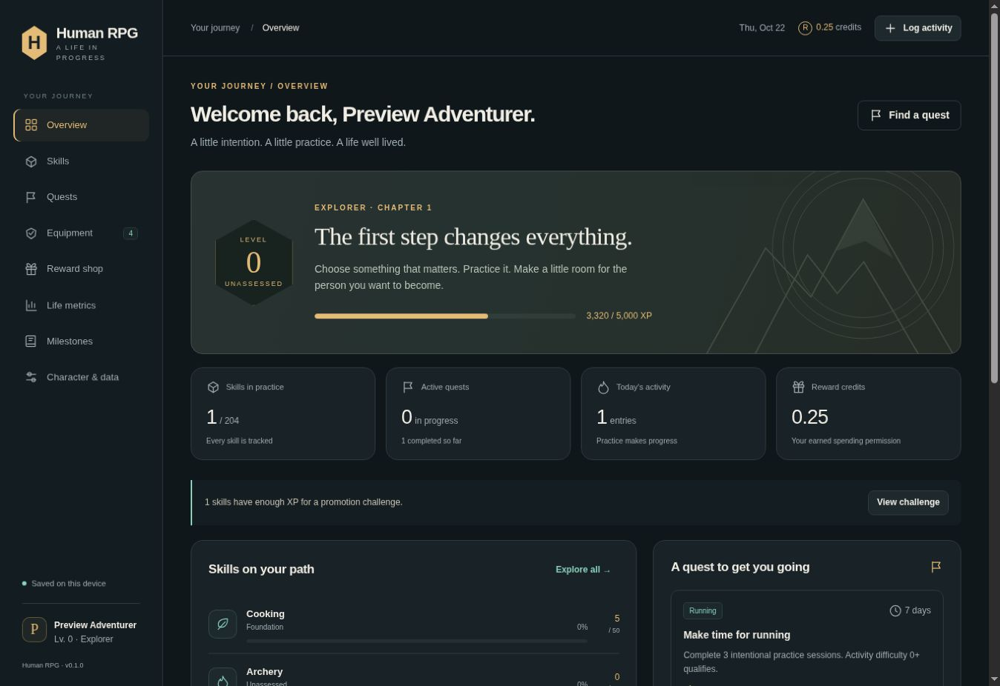
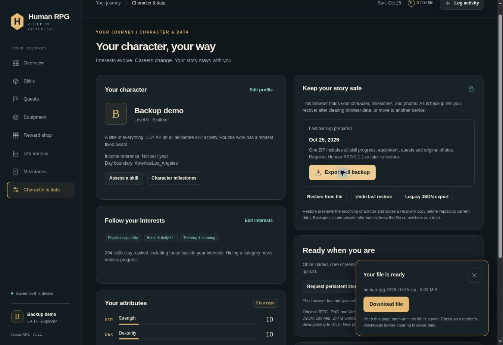
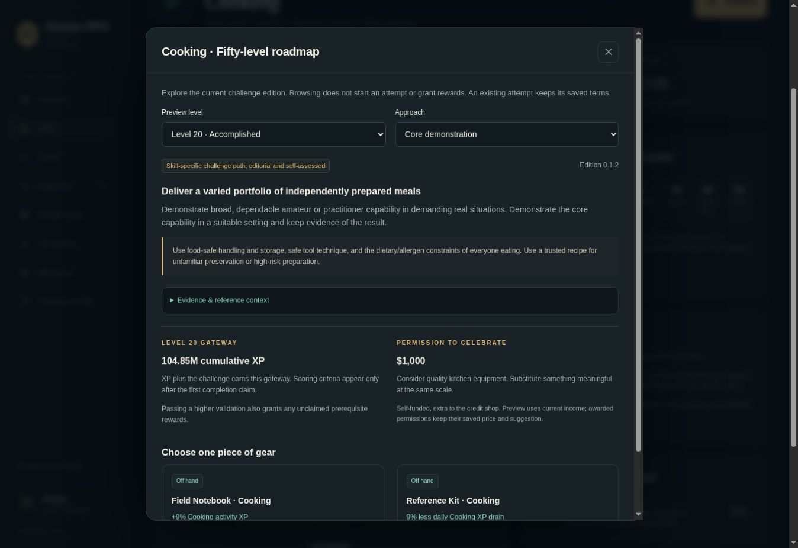

# Human RPG 0.1.2

A local-first life RPG for desktop and mobile browsers, built under `human-rpg/` in `Lordofrealms/Lordofrealms.webapps`. Development is on `human-rpg-dev` in [draft PR #109](https://github.com/Lordofrealms/Lordofrealms.webapps/pull/109). It has not been merged or deployed.

## Implemented

- 204 skills in 14 categories, custom skills, editable interests/classes, Quick Start and optional assessment.
- Fifty ranks per skill, exact doubling XP thresholds, promotion challenges with rubrics revealed after the attempt, and a milestone journal with optional local photos.
- Twenty expanded challenge paths across every category: 580 concrete level 1–29 objectives, evidence context above that, three approaches, and a read-only fifty-level challenge/reward roadmap.
- Saved challenge definitions preserve the terms of each attempt; older attempts retain their original wording.
- Current-skill decay, permanent character XP, free attribute points every five character levels, and separate Reward Credits.
- Ten equipment slots, gear choices, passive effects, active abilities with full cooldown slot locks, and non-stacking legendary reward cascades.
- Open, timed and commitment quests, meaningful task difficulty, credit stakes and audited corrections.
- A credit shop and extra promotion purchase permissions scaled to total annual personal income. These record self-funded rewards; no payment is made.
- Life measurements, sourced comparisons, ranking evidence records and a complete source/gap register.
- IndexedDB persistence, revision conflict protection, full ZIP backups including original photos, optional legacy JSON export, validation before restore and a recoverable pre-restore copy.

## Run and verify

No dependencies or compilation are required. Serve this directory over HTTP for development, for example `python3 -m http.server 8000` from this directory. Use HTTPS or localhost to test service workers and installation; opening `index.html` through `file:` is not supported.

With Node 20 or later:

```sh
npm run check
npm test
node scripts/write-ranking-register.mjs
node scripts/write-challenge-register.mjs
```

The suite currently has **55 passing tests**. Actual browser checks and remaining limits are in [docs/VERIFICATION.md](docs/VERIFICATION.md). The `scripts/prepare-browser-tests.mjs` helper prepares an isolated persistence harness in an existing `dist/` preview; it does not change the app's database.

## Ranking coverage

[docs/RANKINGS.md](docs/RANKINGS.md) covers every catalog skill. There are 53 researched primary skill sources: 194 skills have a ranking, standard, record or explicitly related reference; 10 have documented research gaps. These counts do **not** imply 194 population percentile calculators.

Local calculations support published CDC BMI/waist percentile bands by available age/sex cohorts, Federal Reserve family net-worth medians by age, a frozen Concept2 2,000 m participant distribution, and World Aquatics short-course swimming points. Competition results and qualifications remain distinct from general-population ranks. The [challenge register](docs/CHALLENGES.md) records the twenty expanded paths and 184 general frameworks. High-rank challenges remain editorial evidence standards, not independently reviewed competition requirements.

## Local data and recovery

The app uses no account, analytics, external fonts or CDN and makes no automatic external requests for personal data. Reference links open only when selected. Export backups regularly and before moving devices or clearing site data. Persistent storage is a browser request, not protection against device loss.

Restore replaces the character, previews what will change and retains one pre-restore recovery copy. `Undo last restore` can switch back; export an independent copy beforehand if newer progress matters. Invalid backups leave the current character intact. The checksum detects corruption, not deliberate tampering. Photos are limited to 12 MiB each; normal ZIP backups to 1 GiB; legacy JSON to 100 MiB. The largest collection tested in the browser is 108 MiB, not the full limit. Browser quota and device memory also apply. See [docs/BACKUPS.md](docs/BACKUPS.md) for formats and recovery.

Version 0.1.2 reads existing JSON backups without rewriting old photo records. New photos use binary storage and require 0.1.1 or later. Before downgrading to 0.1.0, save a legacy JSON backup and restore that file in the older version; do not expect the older app to read new binary photo records directly. Collections above the legacy limit cannot downgrade with all photos. Export prepares a visible **Download file** link. “Last backup prepared” does not claim the operating system saved a file; check the downloads folder. Cloud Browser file-saving verification remains pending after download timeouts.

New attempts save their full challenge definition. Review and score them in **0.1.2 or later**: older builds can display older wording even when they can parse the backup. Existing attempts are unchanged. Keep a backup before switching builds; legacy JSON export changes photo encoding, not challenge terms.

## Continue development

Read root/app `AGENTS.md`, [PROJECT_STATE.md](PROJECT_STATE.md), [HANDOFF.md](HANDOFF.md), [docs/PLAN.md](docs/PLAN.md), [docs/DESIGN.md](docs/DESIGN.md), and [docs/DECISIONS.md](docs/DECISIONS.md). The accepted design was committed before implementation in `e0a56efee379e066ad1c084f9ab4ef19870f732d`. Actual character backups and personal photos do not belong in GitHub. This preview contains synthetic test data only.






